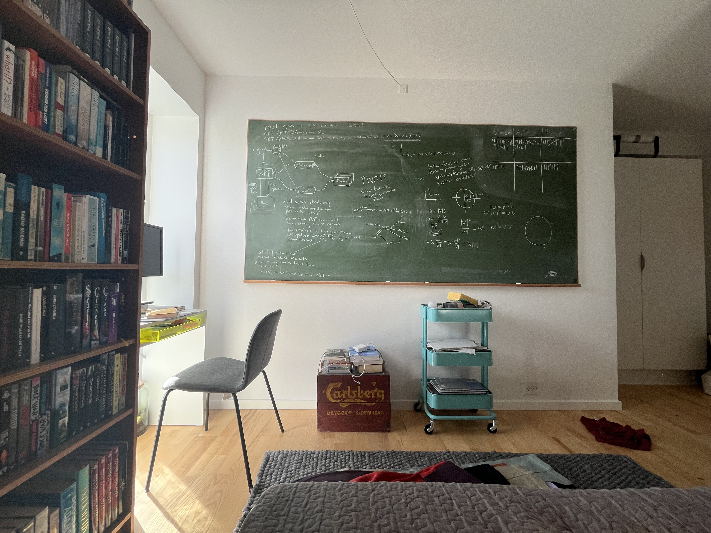

# Blackboards rule

When I was moving into my new apartment I bought a huge blackboard.

While it was an absolute pain in the ass to move in
and chalk is weirdly hard to buy,
I really enjoy having it because

* it makes quickly jotting down ideas very low-friction,
* it's _mad pretentious_ and
* it encourages me to look back at what I was scribbling yesterday.

I particularly enjoy the last point:
often I will wake up,
look at the board
and go
"Aha! Why didn't I floop the gewarth! It's so obvious..."
which is nice.
